<div align="center">

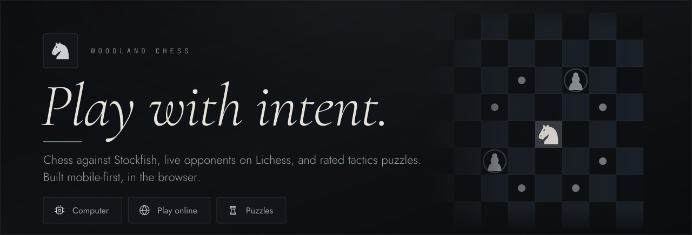

<br/>

<!-- identity -->


<br/>

<!-- stack -->
<a href="https://react.dev">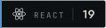</a>
<a href="https://www.typescriptlang.org">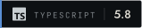</a>
<a href="https://vite.dev"></a>
<a href="https://vitest.dev">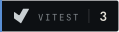</a>

<br/>

<!-- engine and play -->
<a href="https://github.com/nmrugg/stockfish.js"></a>

<a href="https://lichess.org/api#tag/Board"></a>
<a href="https://lichess.org/training"></a>

<br/>

<!-- platform -->
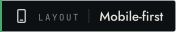


<br/><br/>

*Play Stockfish, meet real opponents on Lichess, and solve rated tactics, all in one dark, mobile-first interface.*

<br/>

[Overview](#overview) · [Features](#features) · [Architecture](#architecture) · [Online play](#online-play) · [Puzzles](#puzzles) · [Design system](#design-system) · [Schools](#playing-schools) · [Getting started](#getting-started) · [Deployment](#deployment) · [Licenses](#licenses)

</div>

---

<a id="overview"></a>
##  Overview

**Woodland Chess** is a mobile-first, browser-native chess application with a handcrafted dark design system. It has four modes that share one visual language:

- **Computer** plays against Stockfish 18 Lite, running locally as a WebAssembly Web Worker. Ten playing schools shape its opening repertoire and three difficulty tiers set its strength.
- **Play online** pairs you with real opponents through your Lichess account, using OAuth with PKCE and the Lichess Board API.
- **Puzzles** serves rated tactics from the Lichess puzzle database, with hints, scoring, streaks, a daily challenge and achievements.
- **My style** reviews your Lichess and computer games with Stockfish on your device, estimates your playing style, and lets you study each game move by move.

There is no backend of our own. Computer mode needs no account and makes no network calls beyond loading fonts. Online play and puzzles talk directly to `lichess.org` from the browser.

The visual design inherits the *Abyssal Liturgy* aesthetic: near-black surfaces, muted steel tokens, Cormorant Garamond italics for display text, Jost for interface copy and JetBrains Mono for eyebrows and notation. Every colour, spacing value and easing curve is a CSS custom property.


---

<a id="features"></a>
##  Features

<table>
<tr>
<td width="50%" valign="top">

 **Gameplay**
- Full legal-move enforcement via `chess.js` (FEN, SAN, PGN)
- Promotion picker for queen, rook, bishop and knight
- Check, checkmate, stalemate and draw detection
- Move history as paired SAN, auto-scrolled
- Play as White, Black or a random side; the board orients to you
- Opponent card, status line and live turn indicator

</td>
<td width="50%" valign="top">

 **Computer mode**
- Stockfish 18 Lite in a Web Worker (WASM)
- 10 playing schools with opening books
- Attack, Focus and Defend profile bars per school
- 3 difficulty tiers: Relaxed, Classic, Expert
- 80 ms move debounce for a smooth feel

</td>
</tr>
<tr>
<td width="50%" valign="top">

 **Online play**
- Sign in with Lichess (OAuth 2 with PKCE, no client secret)
- Four time controls: 3+0, 5+0, 10+0, 15+10
- Live games over the Board API event and game streams
- Optimistic moves that resync if Lichess rejects one
- Two-tap resign to prevent accidents

</td>
<td width="50%" valign="top">

 **Puzzles**
- Real positions from the Lichess puzzle database
- Rating, themes and optional hints
- Daily challenge with a day streak
- Score, solve streak and best streak
- Six achievement definitions with toast notifications
- Synthesised sound effects, with a mute toggle

</td>
</tr>
<tr>
<td width="50%" valign="top">

 **Design system**
- CSS custom property token layer
- Cormorant Garamond, Jost and JetBrains Mono
- Abyssal Liturgy dark palette with semantic accents
- One 24px, 1.2 stroke icon family across every mode
- 2 px card radius, intentionally restrained

</td>
<td width="50%" valign="top">

 **Platform**
- Mobile-first, enhanced with `min-width` queries
- Web App Manifest and icon for Add to Home Screen
- Safe-area insets for notched and home-bar devices
- ARIA grid board, `aria-live` status, keyboard support
- CI/CD to GitHub Pages with direct deep links

</td>
</tr>
</table>

---

<a id="architecture"></a>
##  Architecture

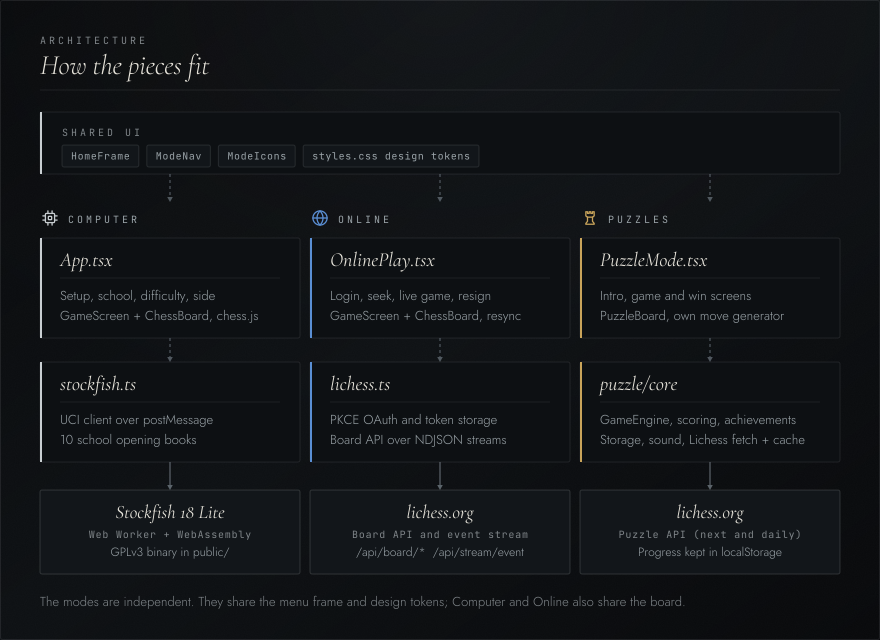

The application has a thin shared layer and four independent modes.

**Routing.** `App.tsx` maps the URL path to a mode: `/ai` (Computer), `/multiplayer` (Online) and `/puzzle` (Puzzles). It uses the History API with no router dependency. Opening `/` redirects to `/ai`, and the deploy workflow copies `index.html` to `404.html` so every route loads directly on GitHub Pages.

**Shared UI.** `HomeFrame` is the frame for every menu screen: brand lockup, `ModeNav`, intro block, content and an action bar. `GameScreen` and `ChessBoard` are shared by Computer and Online. Puzzles use their own `PuzzleBoard`. All icons come from the same 24px family in `ModeIcons.tsx` and `puzzle/components/icons/`.

**Computer.** `chess.js` owns every rule of chess. `stockfish.ts` wraps the Web Worker in a UCI client with a Promise-based `until(match)` queue and holds the ten school opening books.

**Online.** `lichess.ts` implements the PKCE flow, token storage and a Board API client that reads newline-delimited JSON streams. `OnlinePlay.tsx` drives the login, seek, live game and finished phases.

**Puzzles.** `puzzle/core` contains a `GameEngine` state machine, `ScoreService`, `AchievementService`, `StorageService`, `SoundService` and the Lichess puzzle fetcher. Puzzle play runs on its own lightweight move generator in `puzzle/engine`.

---

<a id="online-play"></a>
##  Online play

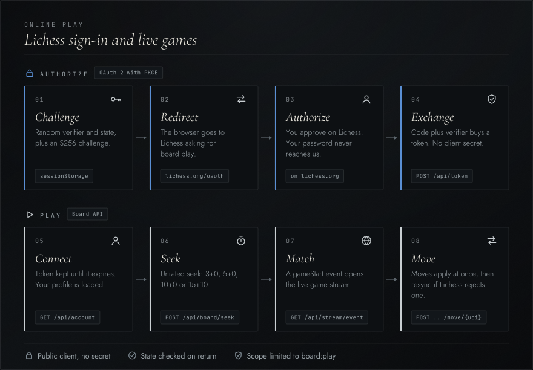

Woodland Chess is an unregistered public OAuth client (`client_id` `woodland-chess`) using the Authorization Code flow with PKCE, so it works on a static host with no server and no secret.

| Item | Detail |
|---|---|
| Scope | `board:play` only |
| Redirect URI | `window.location.origin` plus the Vite base path |
| Token storage | `localStorage` key `woodland-chess:lichess-token`, expiry minus 60 s |
| PKCE data | Verifier and state in `sessionStorage`, cleared after the redirect |
| Games | Unrated, standard variant |
| Time controls | 3+0 Blitz, 5+0 Blitz, 10+0 Rapid, 15+10 Rapid |
| Streams | `/api/stream/event` for `gameStart`, `/api/board/game/stream/{id}` per game |
| Moves | `POST /api/board/game/{id}/move/{uci}`, applied optimistically, resynced on rejection |
| Resign | Two-tap confirm that disarms after 3 seconds |

You need a Lichess account. Locally, sign-in works at `http://localhost:5173/` because the redirect URI follows the current origin.

---

<a id="puzzles"></a>
##  Puzzles

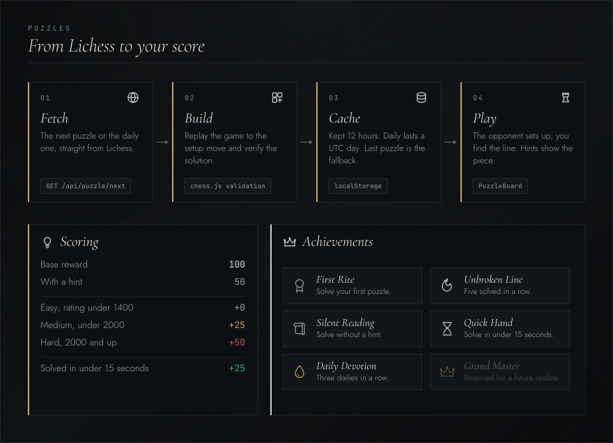

Puzzles come from `GET /api/puzzle/next` and `GET /api/puzzle/daily`, which need no login. Each puzzle is rebuilt from its source game, and every solution move is checked for legality before it is shown. A run keeps fetching puzzles until you leave; the daily challenge is a single puzzle followed by a result screen.

Difficulty comes from the puzzle rating: under 1400 is Easy, under 2000 is Medium, and the rest is Hard.

### Scoring

| Component | Points |
|---|---|
| Base reward | 100 (50 if a hint was used) |
| Difficulty bonus | Easy +0, Medium +25, Hard +50 |
| Speed bonus | +25 for solving in under 15 seconds |

### Achievements

| Icon | Name | Tier | Unlocked by |
|---|---|---|---|
|  | First Rite | Bronze | Solving your first puzzle |
|  | Unbroken Line | Silver | A streak of five solved puzzles |
|  | Silent Reading | Bronze | Solving a puzzle without a hint |
|  | Quick Hand | Silver | Solving a puzzle in under 15 seconds |
|  | Daily Devotion | Gold | Completing the daily challenge three days in a row |
|  | Grand Master | Gold | Defined but not yet awarded |

Progress lives in `localStorage` under `woodland.puzzle.progress.v1`. Fetched puzzles are cached for 12 hours, the daily puzzle for the current UTC day, and the last puzzle is kept as an offline fallback.

---

<a id="design-system"></a>
##  My style

The **My style** tab turns your games into a study. Import public Lichess games (no account permission needed) or finish games against the computer; Stockfish reviews them in a Web Worker on your device and nothing is uploaded.

### How a game is reviewed

- **One search per position.** A game of *n* moves needs *n + 1* searches: the score after a move is the score before the next. Stockfish reports scores from the side to move, so every score is converted to White's point of view before use (`parseInfoScore` / `whitePov` in `stockfish.ts`). Checkmate and stalemate positions are scored directly because the engine returns 0 for them.
- **Winning chances, not raw centipawns.** Scores become winning chances with the Lichess logistic model. A move is graded by the winning chances it gave up: **Inaccuracy** 5 points, **Mistake** 10, **Blunder** 15 (Lichess' thresholds). **Best** means the engine's own choice.
- **Accuracy.** Each move scores `103.1668 * exp(-0.04354 * drop) - 3.1668`; the game accuracy is the mean of a volatility-weighted average and the harmonic mean, as on Lichess.
- **Phases** come from the pieces left on the board (opening until about move 10 with most pieces home; endgame with six or fewer pieces besides pawns and kings).
- **Opening names** come from Lichess when the game has one, otherwise from a small built-in table.

### How the style read works

Seven **style axes** (0-10, where 5 is a typical elite player) describe *how* you play. Strength is deliberately left out: strong players play strong moves in any style, so including it would only match you with weaker players.

| Axis | Measured from |
|---|---|
| Attack | Captures, checks, moves landing near the enemy king, sound sacrifices |
| Sharpness | How often only one move held up (the engine's best line versus its runner-up) |
| Simplify | Material left on the board at your moves, and how often you recapture and trade |
| Risk | Sacrifices the engine still rates as sound, and late castling |
| Safety | Castling early, and how early |
| Endgame | Time spent in endgames and accuracy there compared with the rest of your play |
| Open play | Whether your first pawn move is the e-pawn (open games) or a d/c/flank pawn |

The position-difficulty and material measures follow Guid and Bratko's computer studies of world champions (positions are judged by how far the best move stands out from the second best, and the inclination to simplify by the average material on the board). With few moves the read is pulled toward the middle and labelled **Early read**, **Developing** or **Established** by how many moves were analysed.

**Closest players.** Your fingerprint is compared with a roster of 57 players from Anderssen to Gukesh (`src/profile/players.ts`) using a weighted distance, and the match falls smoothly with distance (one axis-point apart is about 90%, two about 66%, three about 39%), so small differences change the order. The closest school is simply the closest player's school, so the two can never disagree. The roster values are calibrated reference profiles built from the published studies and the standard characterisation of each player and repertoire; they are not measurements. `scripts/measure-players.mjs` measures the engine-free axes from any PGN file (`node scripts/measure-players.mjs "Carlsen" games.pgn`), so individual entries can be replaced with real data.

**Tactics and strategy.** Your costly moves are split by what the engine wanted instead: a capture, check or mate (a tactical oversight) or a quiet move (a positional error). The study also reports how many only-move positions you solved.

**Analysis depth.** Quick (100 ms), Standard (200 ms) and Deep (450 ms) per position. Deeper searches misjudge fewer moves but take longer; everything runs in a Web Worker on your device.

This is an estimate from a small sample, not a verdict. Advice tips quote the numbers behind them and only appear when there is enough evidence; general habits are marked as such.

### Game study

Tapping a game opens a study view built for phones: the board, the current move and the move buttons stay pinned while the graph, key moments and move list scroll. Swipe along the move list or use the buttons (arrow keys, Home and End also work), jump between your errors, and reveal the engine's preferred move.

---

##  Design system

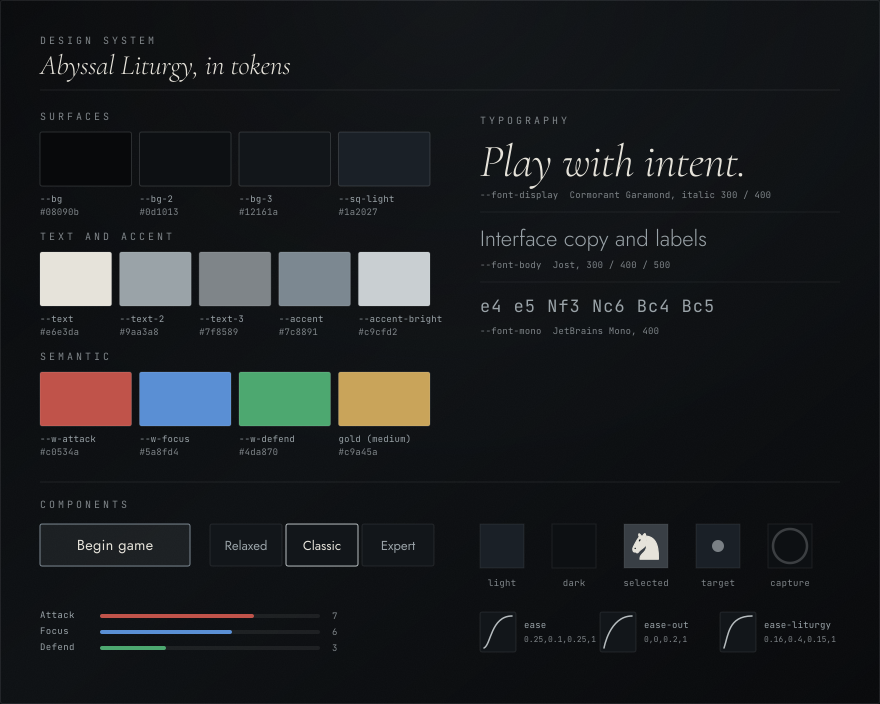

The token set is declared in `:root` within `src/styles.css`. Components consume tokens rather than raw values.

### Colour tokens

| Token | Value | Use |
|---|---|---|
| `--bg` | `#08090b` | Page background |
| `--bg-2` | `#0d1013` | Card surface |
| `--bg-3` | `#12161a` | Elevated surface |
| `--surface` | `rgba(214, 219, 222, 0.035)` | Subtle fill |
| `--border` | `rgba(214, 219, 222, 0.07)` | Default border |
| `--border-hover` | `rgba(214, 219, 222, 0.18)` | Hovered border |
| `--text` | `#e6e3da` | Primary text |
| `--text-2` | `#9aa3a8` | Secondary text |
| `--text-3` | `#7f8589` | Tertiary text and labels |
| `--accent` | `#7c8891` | Interactive accent |
| `--accent-bright` | `#c9cfd2` | Bright accent and highlights |
| `--sq-light` | `#1a2027` | Light board square |
| `--sq-dark` | `#0d1013` | Dark board square |
| `--sq-selected` | `rgba(201, 207, 210, 0.18)` | Selected square |
| `--sq-target` | `rgba(201, 207, 210, 0.55)` | Legal move dot |
| `--sq-capture` | `rgba(201, 207, 210, 0.25)` | Capture ring |

### Semantic tokens

| Token | Value | Use |
|---|---|---|
| `--w-attack` | `#c0534a` | Attack bar, hard puzzles |
| `--w-focus` | `#5a8fd4` | Focus bar |
| `--w-defend` | `#4da870` | Defend bar |
| `--pz-good` | `#4da870` | Correct puzzle move |
| `--pz-bad` | `#c0534a` | Wrong puzzle move |
| `--pz-hint` | `rgba(192, 83, 74, 0.38)` | Hint highlight |
| medium badge | `#c9a45a` | Medium puzzle difficulty |

### Typography

```
--font-display  Cormorant Garamond  headings, brand name, italic 300 / 400
--font-body     Jost                all interface copy, weight 300 / 400 / 500
--font-mono     JetBrains Mono      eyebrows, kickers, move notation
```

### Easing

```
--ease          cubic-bezier(0.25, 0.1, 0.25, 1)    standard
--ease-out      cubic-bezier(0, 0, 0.2, 1)           decelerate
--ease-liturgy  cubic-bezier(0.16, 0.4, 0.15, 1)     signature; cards and overlays
```

### Pieces and icons

Pieces are one neutral SVG set (cburnett) recoloured at render time with a CSS filter: warm ivory for White (`--text`) and cool steel for Black (`--text-2`). Both clear the WCAG 3:1 non-text contrast minimum on either square colour. Icons share a 24px grid, a 1.2 stroke, round caps and `currentColor`, and no emoji are used anywhere in the interface.

---

<a id="playing-schools"></a>
##  Playing schools

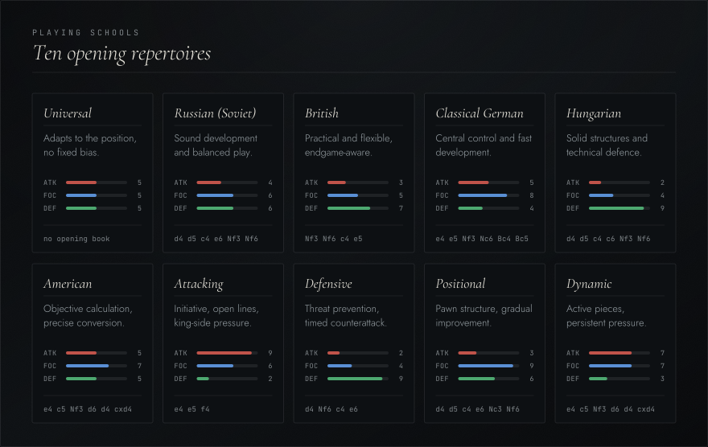

Each school carries an opening book. While the game so far matches a book line, the engine plays the next book move directly and Stockfish is bypassed. Once the line ends or you deviate, Stockfish takes over at the chosen difficulty. The Attack, Focus and Defend bars describe the school's character; they do not change Stockfish's strength.

| School | Tendency | Book line |
|---|---|---|
| **Universal** | No fixed bias, fully adaptive | none |
| **Russian (Soviet)** | Sound development, balanced | `d4 d5 c4 e6 Nf3 Nf6` |
| **British** | Practical, flexible, endgame-aware | `Nf3 Nf6 c4 e5` |
| **Classical German** | Central control, fast development | `e4 e5 Nf3 Nc6 Bc4 Bc5` |
| **Hungarian** | Solid structures, technical defence | `d4 d5 c4 c6 Nf3 Nf6` |
| **American** | Objective calculation, precise conversion | `e4 c5 Nf3 d6 d4 cxd4` |
| **Attacking** | Initiative, open lines, king-side pressure | `e4 e5 f4` (King's Gambit) |
| **Defensive** | Threat prevention, timed counterattack | `d4 Nf6 c4 e6` |
| **Positional** | Pawn structure, gradual improvement | `d4 d5 c4 e6 Nc3 Nf6` |
| **Dynamic** | Active pieces, persistent pressure | `e4 c5 Nf3 d6 d4 cxd4` (Sicilian) |

---

##  Difficulty tiers

Each tier sets Stockfish's Skill Level (0 to 20) and its `movetime` budget:

| Tier | Skill Level | Move time | Character |
|---|---|---|---|
| **Relaxed** | 5 | 150 ms | Blunders regularly; good for beginners |
| **Classic** | 13 | 650 ms | Sound chess with occasional inaccuracies |
| **Expert** | 20 | 1 600 ms | Near the maximum strength of Stockfish Lite |

---

<a id="getting-started"></a>
##  Getting started

**Prerequisites:** Node.js 22 or later, and npm.

```bash
git clone https://github.com/woodlandChess/woodlandChess.github.io.git
cd woodlandChess.github.io
npm install
npm run dev
```

Open [http://localhost:5173](http://localhost:5173). The dev server hot-reloads on every save. Direct routes are `/ai`, `/multiplayer` and `/puzzle`.

```bash
npm run build      # tsc -b, then vite build into dist/
npm run preview    # serve the production build locally
npm test           # vitest run (no watch)
```

The suite in `src/engine.test.ts` covers the reference minimax engine: evaluation, checkmate scoring, wrong-colour and game-over handling, and school weights.

---

<a id="deployment"></a>
##  Deployment

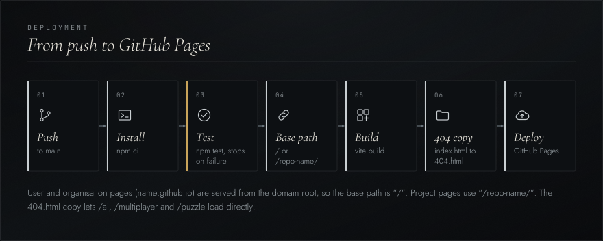

`.github/workflows/deploy.yml` runs on every push to `main` and on manual dispatch:

1. Checks out the repo and sets up Node 22 with npm caching
2. Runs `npm ci` for a clean, reproducible install
3. Runs `npm test`; any failure aborts the deploy
4. Resolves the Vite base path: `/` for `<account>.github.io` repos, `/<repo-name>/` for project pages
5. Builds with `VITE_BASE_PATH` injected
6. Copies `dist/index.html` to `dist/404.html` so `/ai`, `/multiplayer` and `/puzzle` load directly
7. Uploads `dist/` and deploys with `actions/deploy-pages`

**To enable:** open **Settings, Pages, Build and deployment** and choose **GitHub Actions**.

---

##  Project structure

```
woodlandChess.github.io/
├── assets/                          README artwork (banner, footer, diagrams, badges, icons)
│   ├── badges/                      Brand-styled badge SVGs
│   └── icons/                       24px icon family used in headings
├── public/
│   ├── icon.svg                     PWA and favicon icon
│   ├── manifest.webmanifest         Web App Manifest
│   ├── stockfish-18-lite-single.js  Stockfish loader
│   ├── stockfish-18-lite-single.wasm  Engine binary (about 7 MB)
│   └── stockfish-COPYING.txt        GPLv3 text
├── scripts/
│   └── measure-players.mjs          Measure style axes from PGN files
├── src/
│   ├── App.tsx                      Router, Computer mode, setup UI
│   ├── OnlinePlay.tsx               Online mode: login, seek, live game
│   ├── lichess.ts                   OAuth PKCE and Board API client
│   ├── stockfish.ts                 UCI client, schools, opening books
│   ├── engine.ts                    Reference minimax, evaluation, game status
│   ├── engine.test.ts               Vitest unit tests
│   ├── ChessBoard.tsx               Shared board grid and promotion modal
│   ├── pieces.ts                    Piece SVGs as data URIs
│   ├── components/
│   │   ├── HomeFrame.tsx            Shared menu frame
│   │   ├── ModeNav.tsx              Computer, Online, Puzzles, My style navigation
│   │   ├── Controls.tsx             Shared Segmented control and WeightBar
│   │   ├── ModeIcons.tsx            Mode and utility icons
│   │   └── GameScreen.tsx           Shared in-game layout, ConfirmButton
│   ├── profile/
│   │   ├── PlayerProfile.tsx        My style screen: import, summary, games
│   │   ├── GameStudy.tsx            Move-by-move study view
│   │   ├── analysis.ts              Game import and Stockfish review
│   │   ├── stats.ts                 Winning chances, grading, accuracy
│   │   ├── style.ts                 Style axes, school matching, advice
│   │   ├── openings.ts              Opening names
│   │   ├── players.ts               Roster of 57 players and the seven style axes
│   │   └── store.ts                 Saved games and reviews (localStorage)
│   ├── puzzle/
│   │   ├── PuzzleMode.tsx           Puzzle mode entry
│   │   ├── components/              Intro, game, win, board, header, info, toast, icons/
│   │   ├── core/                    GameEngine, Score, Achievement, Storage, Sound, Lichess
│   │   ├── engine/                  Board, MoveGenerator, ChessEngine
│   │   ├── hooks/                   useGameEngine
│   │   └── types/                   Shared puzzle types
│   ├── lazyModes.ts                 Lazy-loaded screens and prefetching
│   ├── styles/
│   │   ├── base.css                 Design system, menus, shared board (loaded first)
│   │   ├── game.css                 Game screen (loaded with a game)
│   │   ├── online.css               Online mode
│   │   ├── puzzle.css               Puzzle mode
│   │   └── profile.css              My style and game study
│   └── main.tsx                     React entry point
├── .github/workflows/deploy.yml     CI/CD to GitHub Pages
├── index.html                       Vite entry point
├── vite.config.ts                   Vite config (base path from env)
├── tsconfig.json                    TypeScript project references
├── tsconfig.app.json                App compiler options
├── tsconfig.node.json               Node compiler options
└── package.json
```

---

##  Component reference

### `<App />`

Owns routing and Computer mode. A mutable `Chess` instance lives in a `useRef` and a FEN snapshot in `useState`, so the game object is never recreated on render while the FEN drives all derived display.

| State | Type | Purpose |
|---|---|---|
| `mode` | `'ai' \| 'online' \| 'puzzle'` | Active mode, synced to the URL |
| `fen` | `string` | Current position |
| `history` | `Move[]` | Verbose move list |
| `selected` | `Square \| null` | Highlighted square |
| `difficulty` | `Difficulty` | Relaxed, Classic or Expert |
| `school` | `ChessSchool` | Opening school |
| `player` / `sideChoice` | `Color` / `Color \| 'random'` | Your side |
| `setupOpen` | `boolean` | Setup screen visibility |
| `pendingPromotion` | `{from, to} \| null` | Awaiting a promotion choice |

### Shared components

| Component | Role |
|---|---|
| `Dropdown` | Accessible custom listbox; anchored panel on desktop, bottom sheet on phones |
| `Segmented` | Radio-based segmented control with native arrow-key support |
| `HomeFrame` | Brand, mode navigation, intro, content and pinned action bar |
| `ModeNav` | Marks the current mode with `aria-current`, navigates to the others |
| `GameScreen` | Opponent card, board, status, moves, optional profile and actions |
| `ConfirmButton` | Two-tap destructive action that disarms after 3 seconds |
| `ChessBoard` | ARIA `grid` of buttons, oriented to the player, with `board--locked` when inactive |
| `PromotionModal` | Piece picker shown when a pawn reaches the last rank |

### `StockfishClient`

Wraps a `Worker` running the WASM build and speaks UCI over `postMessage`:

```ts
await client.bestMove(fen, 'Classic')
// resolves to 'e2e4', or null
```

### `LichessClient`

```ts
const client = new LichessClient(token.access_token)
await client.getProfile()                 // GET /api/account
for await (const evt of client.streamEvents(signal)) { /* gameStart ... */ }
await client.seek(timeControl, signal)    // POST /api/board/seek
await client.move(gameId, 'e2e4')         // POST /api/board/game/{id}/move/e2e4
```

### `GameEngine` (puzzles)

A subscribable state machine consumed through `useGameEngine`. It owns the puzzle list, selection and hint state, feedback, scoring, streaks and achievements, and exposes immutable snapshots to React.

---

##  Engine details

### Stockfish 18 Lite

A single-threaded WASM build of Stockfish 18, loaded as a Web Worker from `public/stockfish-18-lite-single.js`, which bootstraps the `.wasm` from the same directory. It is created on mount and disposed (`quit`, then `terminate`) on unmount. All Computer-mode moves come from Stockfish or an opening book.

```
send  uci
recv  uciok
send  isready
recv  readyok
send  setoption name Skill Level value <n>
send  ucinewgame
send  position fen <fen>
send  go movetime <ms>
recv  bestmove <move>
```

### Reference minimax (`engine.ts`)

A pure TypeScript alpha-beta minimax with a material and positional evaluation. The app no longer uses it to choose moves; it supplies `gameStatus` and `schoolWeights`, and it stays as a tested reference implementation (depth 2, 3 and 4 for the three tiers).

```
score = sum of (material value + positional bonus) x side multiplier
```

Material values are P 100, N 320, B 330, R 500, Q 900 and K 20 000, with piece-square tables per piece type.

---

##  Accessibility and platform

- The board is an ARIA `grid` of labelled buttons, such as "e4 white knight"
- Turn and result changes are announced through `aria-live` regions
- Segmented controls use native radio inputs, giving arrow-key and screen-reader support for free
- Layouts use `100dvh`, safe-area insets and 44 px or larger touch targets
- The manifest and `icon.svg` allow Add to Home Screen; there is no service worker, so a connection is required

---

##  Privacy and data

| What | Where | Why |
|---|---|---|
| Lichess access token | `localStorage` | Stay signed in until expiry |
| PKCE verifier and state | `sessionStorage` | Complete the sign-in, then removed |
| Puzzle progress and caches | `localStorage` | Score history, achievements, offline fallback |
| Saved games and reviews (My style) | `localStorage` | Your style read and game study, up to 100 games, on this device only |
| Network requests | `lichess.org`, Google Fonts | Online play, puzzles, typefaces |

There is no analytics code and no server of our own. Clearing site data removes everything above.

---

<a id="licenses"></a>
##  Licenses and credits

| Component | License | Notes |
|---|---|---|
| Application source | MIT | `src/`, `public/icon.svg`, `public/manifest.webmanifest` |
| Stockfish 18 Lite | **GPLv3** | `public/stockfish-18-lite-single.js` and `.wasm`; text in `public/stockfish-COPYING.txt` |
| Chess piece artwork | CC BY-SA 3.0 | cburnett set by Colin M.L. Burnett, also used by Lichess and Wikipedia |
| Typefaces | SIL OFL 1.1 | Cormorant Garamond, Jost, JetBrains Mono, loaded from Google Fonts |
| Puzzle data | CC0 | The Lichess puzzle database |

> **Important:** Stockfish is licensed under the GNU General Public License v3. If you distribute a modified version of this application that includes the Stockfish binaries, the source of those modifications must also be available under GPLv3. The application source itself is independently MIT-licensed. See `public/stockfish-COPYING.txt` and the [Stockfish.js project](https://github.com/nmrugg/stockfish.js).

The knight mark in the README artwork is derived from the cburnett knight and carries the same CC BY-SA 3.0 license.

---

##  Contributing

1. Fork the repository
2. Create a branch: `git checkout -b feat/my-change`
3. Make your changes
4. Run `npm test` and make sure it passes
5. Open a pull request against `main`

Guidelines:

- **Tokens first.** Add new values to `:root` rather than hardcoding them in component rules.
- **Icons.** Draw on the 24px grid with a 1.2 stroke, round caps and `currentColor`. Do not use emoji or text glyphs as icons.
- **UCI order.** In `stockfish.ts`, keep `setoption` before `ucinewgame`; Stockfish is sensitive to it.
- **Mode isolation.** Puzzle styles are scoped under `.puzzle-shell`, `.puzzle-intro` and `.puzzle-win` so they cannot leak into the main game.

---

<div align="center">

<br/>


</div>
